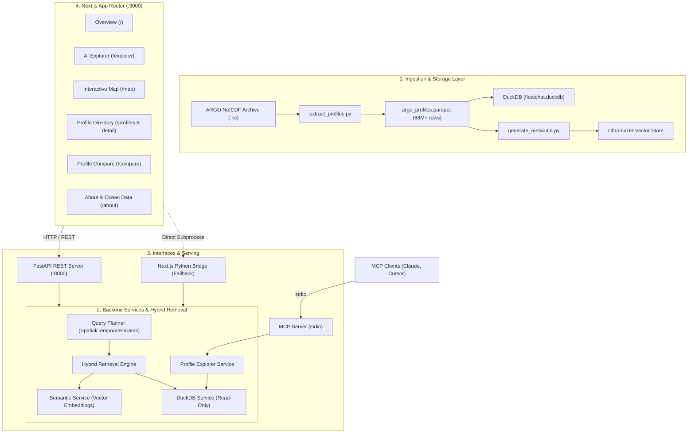

# FloatChat (OceanIQ) 🌊

[](https://nextjs.org/)
[](https://react.dev/)
[](https://www.python.org/)
[](https://duckdb.org/)
[](https://www.trychroma.com/)
[](https://fastapi.tiangolo.com/)
[](https://modelcontextprotocol.io/)

**FloatChat** (also developed as **OceanIQ**) is an end-to-end oceanographic data discovery, conversational retrieval, and analytical platform. It processes raw NetCDF ocean profile data from the international **ARGO Float Program**, structures over **68 million observation records** across the Indian Ocean basin into high-performance columnar and vector storage, and exposes them through natural-language conversational search, interactive spatial mapping, and physical parameter profiling.

---

## 🌟 Key Features

- **🤖 Conversational AI Explorer**: Natural-language query interface with rule-based query planning, parameter extraction (temperature, salinity, depth), spatial/temporal parsing, validation warnings, and transparent hybrid ranking explanations.
- **🗺️ Interactive Ocean Map**: High-performance Leaflet-based map rendering geolocated ARGO float profiles with bounding-box filters, radius searches, date ranges, and parameter availability markers.
- **📈 Scientific Parameter Profiling**: Visualize high-resolution vertical ocean columns (Depth vs. Temperature, Depth vs. Salinity, and T-S scatter plots) powered by Recharts using real observational measurements without artificial interpolation.
- **⚖️ Profile Comparison Engine**: Multi-profile side-by-side analysis calculating exact geodesic distances (Haversine), observation time deltas, and missing parameter identification.
- **⚡ Dual Storage Engine**:
  - **DuckDB**: Blazing-fast columnar SQL engine handling 68M+ observation rows, spatial boundaries, and analytical aggregations with read-only enforcement.
  - **ChromaDB**: Semantic vector database (`all-MiniLM-L6-v2`) providing float-level context retrieval and unstructured query matching.
- **🔌 Model Context Protocol (MCP) Server**: Full stdio-based MCP server enabling AI assistants (like Claude Desktop, Windsurf, or Cursor) to query ocean profiles via standardized read-only tools.
- **🚀 Flexible Serving Modes**: Run via a dedicated **FastAPI HTTP REST API** on port `8000` or zero-setup **Next.js Subprocess Bridge** directly invoking the Python environment.

---

## 🏗️ Architecture



---

## 📁 Repository Structure

```text
FloatChat/
├── archive/                     # Raw ARGO NetCDF archive (.nc files)
├── backend/                     # Python backend services and data layer
│   ├── api_server.py            # Production FastAPI REST application
│   ├── config.py                # Centralized settings via pydantic-settings / dotenv
│   ├── health.py                # Safe read-only system and dataset health audit
│   ├── requirements.txt         # Backend Python dependencies
│   ├── data/
│   │   ├── chroma/              # Persistent ChromaDB semantic vector index
│   │   └── processed/           # Materialized floatchat.duckdb & parquet tables
│   ├── ingestion/               # ETL scripts (NetCDF -> Parquet -> DuckDB -> Chroma)
│   │   ├── extract_profiles.py  # NetCDF parser & row-per-observation extractor
│   │   ├── build_duckdb.py      # DuckDB table builder & indexer
│   │   └── build_chroma_index.py# Vector store embedding builder
│   ├── mcp_server/              # Model Context Protocol stdio server & tools
│   │   ├── server.py            # MCP stdio entrypoint
│   │   └── tools.py             # 5 read-only MCP exploration tools
│   ├── models/
│   │   └── schemas.py           # Pydantic schemas for requests, plans & responses
│   ├── services/
│   │   ├── duckdb_service.py    # Read-only bounded DuckDB SQL execution
│   │   ├── semantic_service.py  # ChromaDB vector retrieval service
│   │   ├── spatial_temporal_service.py # Geospatial & time-window filters
│   │   ├── hybrid_service.py    # Semantic + deterministic filter fusion
│   │   ├── query_planner.py     # Rule-based natural-language query parser
│   │   ├── orchestration_service.py # End-to-end query workflow coordinator
│   │   ├── llm_service.py       # Optional LLM integration & interpretation
│   │   └── profile_explorer_service.py # High-performance profile exploration
│   └── tests/                   # 80+ pytest regression & integration tests
├── docs/                        # Complete design docs, data flow & specifications
├── frontend/                    # Next.js 16 web application
│   ├── package.json             # Frontend dependencies & scripts
│   ├── src/
│   │   ├── app/                 # App Router pages (/explorer, /map, /profiles, etc.)
│   │   │   └── api/             # Next.js internal API routes & Python bridge
│   │   ├── components/          # Reusable UI components (charts, maps, layout)
│   │   └── lib/                 # Client API helpers, TypeScript interfaces & formatters
├── .env.example                 # Example root environment configuration
├── PROJECT_STATUS.md            # Verified stage-by-stage audit and evidence
└── README.md                    # Project documentation (this file)
```

---

## ⚡ Quickstart & Execution Guide

### Prerequisites
- **Python**: `3.10+` (tested with Python 3.13)
- **Node.js**: `18.18+` or `20+`
- **npm** or **pnpm** / **yarn**

---

### Step 1: Environment Setup

Clone the repository and prepare your virtual environment:

```powershell
# Clone the repository
git clone https://github.com/your-username/FloatChat.git
cd FloatChat

# Windows PowerShell: Activate existing or create a new virtualenv
python -m venv .venv
.\.venv\Scripts\Activate.ps1

# Install backend dependencies
pip install -r backend/requirements.txt
```

*(On macOS/Linux, use `source .venv/bin/activate` and `pip install -r backend/requirements.txt`)*

Copy the root environment template:
```powershell
cp .env.example .env
```

To verify that the dataset and environment are healthy:
```powershell
.\.venv\Scripts\python.exe -c "import sys; sys.path.insert(0, 'backend'); from health import get_runtime_health; print(get_runtime_health())"
```

---

### Step 2: Running the Backend

#### Option A: FastAPI HTTP Server (Recommended)
Starts the high-performance async REST API with interactive OpenAPI docs:

```powershell
cd backend
..\.venv\Scripts\python.exe -m uvicorn api_server:app --host 127.0.0.1 --port 8000 --reload
```
- **API Base URL**: `http://127.0.0.1:8000`
- **Interactive Swagger Docs**: `http://127.0.0.1:8000/docs`
- **Health Endpoint**: `http://127.0.0.1:8000/health`

#### Option B: MCP Server (for AI Assistants)
Launch the Model Context Protocol stdio server to connect FloatChat with Claude Desktop or Cursor:

```powershell
cd backend
..\.venv\Scripts\python.exe -m mcp_server.server
```

---

### Step 3: Running the Frontend (Next.js Dashboard)

Open a new terminal window:

```powershell
cd frontend

# Configure frontend environment to point to FastAPI
cp .env.example .env.local

# Install frontend dependencies
npm install

# Start Next.js development server
npm run dev
```

Open **[http://localhost:3000](http://localhost:3000)** in your browser!

> **Note on Serving Modes**:
> - If `NEXT_PUBLIC_API_BASE_URL=http://localhost:8000` is set in `frontend/.env.local`, the frontend makes direct HTTP fetch calls to the running FastAPI server.
> - If `NEXT_PUBLIC_API_BASE_URL` is omitted, Next.js API routes will transparently invoke local Python subprocesses (`.venv/Scripts/python.exe`) without needing FastAPI to run.

---

## 💬 AI Explorer & Conversational Queries

The **AI Explorer** (`/explorer`) translates natural language into structured scientific query plans, evaluates spatial/temporal constraints, and provides full transparency through **Interpretation Notes**, **Validation Warnings**, and **Data Limitations**.

### Example Queries to Try:

| Query Type | Example Prompt | Expected Behavior |
| :--- | :--- | :--- |
| **Standard Retrieval** | `Show salinity profiles in the Bay of Bengal.` | Returns matching floats, applied region filters, and hybrid relevance scores. |
| **Spatial / Radius** | `Find ARGO floats near latitude 0 and longitude 80 within 500 km.` | Parses coordinates, computes geodesic radius, and returns geolocated floats. |
| **Temporal Window** | `Show available observations from March 2023.` | Restricts time bounds to `2023-03-01` → `2023-03-31`. |
| **Unsupported Parameter Warning** | `Show chlorophyll and oxygen profiles in the Arabian Sea.` | Raises **Validation Warning**: flags unsupported biochemical parameters (only temperature, salinity, and depth are validated). |
| **Unresolved Region Warning** | `Show salinity profiles in the Pacific Ocean.` | Raises **Validation Warning**: notes that query is outside the indexed Indian Ocean basin. |
| **Coordinate Range Warning** | `Find floats near latitude 105 and longitude 80.` | Raises **Validation Warning**: detects latitude out-of-bounds `[-90, 90]`. |
| **Inverted Date Range** | `Show observations from December to January 2023.` | Raises **Validation Warning**: start date later than end date. |

---

## 🗺️ Application Views

- **`/` — Dataset Overview**: Live metrics for 68M+ observations, 52k+ profile casts, UTC date boundaries, and regional breakdown.
- **`/explorer` — AI Explorer**: Natural-language query interface with structured query inspection and ranking scores.
- **`/map` — Interactive Map**: Leaflet ocean map with clustered markers, region bounding boxes, and instant metadata inspection.
- **`/profiles` — Profile Directory**: Paginated directory of float profiles filterable by region, date, parameter, and float key.
- **`/profiles/detail` — Profile Detail**: Vertical ocean charts (Depth vs. Temperature, Depth vs. Salinity, and T-S diagrams).
- **`/compare` — Profile Comparison**: Multi-profile overlay chart comparing profiles across different ocean regions or seasons.
- **`/about` — Data & Quality Notes**: Scientific documentation regarding ARGO QC flags, UTC timestamp normalization, and float identifier semantics.

---

## 🧪 Testing & Validation

FloatChat includes a comprehensive regression and validation test suite covering the data ingestion, query planner, spatial/temporal queries, hybrid retrieval, and API serialization.

Run the test suite using pytest:

```powershell
.\.venv\Scripts\python.exe -m pytest backend/tests -v
```

To test frontend compilation and linting:

```powershell
cd frontend
npm run lint
npm run build
```

---

## 🔬 Scientific & Data Notes

1. **ARGO Floats & Identification**:
   - In raw NetCDF files, the authoritative World Meteorological Organization identifier is stored under `PLATFORM_NUMBER`.
   - The field `float_id` in processed DuckDB/Parquet tables represents the internal project-level float key.
   - Individual ocean profiles are uniquely identified by the tuple `(file_name, profile_number)`.
2. **Quality Control & Measurements**:
   - All plotted profile curves reflect actual recorded observations; no artificial polynomial interpolation or extrapolation is performed across missing depth levels.
3. **Time Normalization**:
   - All dates and timestamps are parsed, converted, and stored in **ISO 8601 UTC**.

---

## 📄 License

This project is licensed under the [MIT License](LICENSE).
ARGO float data is freely collected and contributed by the international ARGO program and national data centers.
