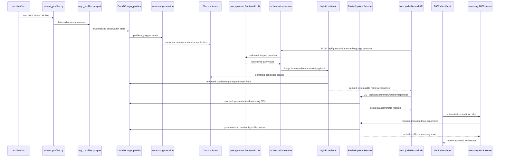

# Data Flow

## End-to-end pipeline

## Flow details

1. NetCDF archive inspection uses `inspect_netcdf.py` to establish source dimensions and variables.
2. `extract_profiles.py` reads `PLATFORM_NUMBER`, `JULD`, coordinates, and pressure/temperature/salinity arrays and writes flattened observations to parquet.
3. `build_duckdb.py` materializes the processed table in DuckDB.
4. `generate_metadata.py` aggregates float-level metadata.
5. `build_chroma_index.py` embeds metadata summaries and stores them in the persistent Chroma collection.
6. `query_planner.py` converts natural-language scientific questions into validated structured inputs. Optional `llm_service.py` can propose a plan, but validates it and retains the deterministic fallback.
7. `orchestration_service.py` stops on invalid or clarification-required plans, otherwise invokes the hybrid service.
8. `hybrid_service.py` combines Chroma semantic results with enforced DuckDB spatial, temporal, and parameter constraints and returns explainable ranking details.
9. `frontend/src/app/api/query/route.ts` starts the local Python orchestration path and returns its structured response to the query explorer.
10. `backend/services/profile_explorer_service.py` supports dashboard exploration with four read-only operations:
    - `get_summary()` returns counts, non-null field totals, UTC coverage, coordinate bounds, configured regional profile counts, and explicit QC/identifier limitations.
    - `list_profiles(...)` returns a page of grouped profile records and supports identifier text, parameter availability, region, time, and coordinate-range filters.
    - `map_profiles(...)` returns bounded distinct profile coordinates with the same supported filters.
    - `get_profile(file_name, profile_number, limit=...)` returns one profile's metadata and bounded actual measurement rows.
11. `frontend/src/app/api/data/[action]/route.ts` exposes only `summary`, `profiles`, `map`, and `profile` actions. SQL remains server-side and query values are bound parameters.
12. The overview, query explorer, map, profile listing/detail, and comparison pages render these service responses. The UI does not fabricate scientific values or execute database queries directly.
13. An MCP host launches `python -m mcp_server.server` from `backend/` and communicates over stdio. Five tools call the same read-only `ProfileExplorerService`: `search_argo_profiles`, `get_float_details`, `get_profile_observations`, `compare_profiles`, and `get_dataset_summary`. Tool input validation and response models live in `backend/mcp_server/`; no unrestricted SQL or new retrieval path is exposed.

## Dashboard limits and runtime

- Profile identity is `(file_name, profile_number)`, while `float_id` is the project key and source filename remains provenance.
- Backend caps: profile pages at 200 rows, map results at 2,000 locations, and profile levels at 10,000 rows. UI caps are 50 per page, 1,500 markers, 3,000 levels on detail pages, and 2,000 levels per comparison profile.
- MCP caps: profile search 200 profiles, observation responses 2,000 levels, and comparison 2–4 profile identities with at most 2,000 returned levels each. The source service limits profile loading to 10,000 levels.
- Python subprocesses run once per Next.js API request. This is a local integration and has per-request startup latency; no persistent Python HTTP service is part of Stage 10.
- The observed local dataset has 68,470,264 observation rows, 52,240 `(file_name, profile_number)` profile identities, and 706 project float keys/source files. Observation coverage is 2022-01-01 to 2024-12-20 UTC.

## Identifier and data interpretation

- `PLATFORM_NUMBER` in the original NetCDF is the source of the raw ARGO platform identifier.
- Processed `float_id` is the project-level identifier; a separate raw `PLATFORM_NUMBER` column is not retained in DuckDB.
- `file_name` identifies source provenance and is never treated as a float identifier.
- The processed `depth` field contains NetCDF `PRES`; dashboard charts label it pressure (dbar) and do not convert it to geometric depth.
- QC fields are not present in the processed schema. The dashboard reports QC as unavailable.
- MCP float details aggregate only exact processed `float_id` values. Raw `PLATFORM_NUMBER` is not independently persisted; comparison results are separate observed series without interpolation.

## UTC handling

Temporal retrieval and serialization use UTC consistently. Dashboard date filters interpret naive inputs as UTC, convert timezone-aware inputs to UTC, and treat date-only end values as inclusive through the end of that UTC day.

MCP date filters use the same service behavior and validate ISO-8601 inputs; date-only end dates are inclusive through the end of the UTC day. Tool results preserve UTC-normalized service timestamps.
