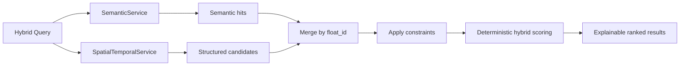

# Hybrid Retrieval Architecture

## Purpose

The hybrid retrieval engine integrates Chroma semantic search with DuckDB spatial and temporal retrieval while keeping the LLM out of the retrieval pipeline. The service is designed for deterministic merging, explainable ranking, and CPU-efficient execution.

## Components

### Query planning

- `backend/services/query_planner.py`
- Accepts a natural-language question and produces a validated `QueryPlan` object.
- Converts supported scientific parameters, regions, coordinates, radii, and dates into the Stage 7 retrieval contract.
- Keeps planning separate from actual retrieval and ranking logic.

### Semantic retrieval

- `backend/services/semantic_service.py`
- Uses the persisted Chroma collection created by `build_chroma_index.py`.
- Returns float-level metadata and semantic similarity scores.
- Input: natural-language query text.
- Output: ranked semantic hits with `document`, `score`, and `metadata`.

### Structured retrieval

- `backend/services/spatial_temporal_service.py`
- Uses read-only DuckDB queries with parameterized SQL.
- Applies:
  - bbox filtering,
  - radius filtering,
  - region search,
  - date-range search,
  - month-based search,
  - nearest-float grouping.

### Hybrid service

- `backend/services/hybrid_service.py`
- Accepts a `HybridRetrievalQuery` payload.
- Merges semantic hits and structured candidates by `float_id`.
- Enforces spatial and temporal filters as actual retrieval constraints.
- Produces explainable ranked results.

## Planning vs retrieval

Query planning is a translation layer. Retrieval remains the responsibility of the hybrid service, which enforces filters, ranks candidates, and returns explainable output. The planner does not make retrieval decisions; it only converts natural-language input into a validated structured payload.

## Query contract

The hybrid service accepts the following fields:

- `query`: original natural-language request.
- `semantic_text`: optional semantic query override.
- `latitude`, `longitude`: point-based radius search values.
- `latitude_min`, `latitude_max`, `longitude_min`, `longitude_max`: bbox values.
- `radius_km`: radius in kilometres.
- `region`: named region such as `Bay of Bengal`.
- `start_datetime`, `end_datetime`: inclusive temporal window.
- `parameters`: requested oceanographic parameters such as `temperature`, `salinity`, and `depth`.
- `max_results`: maximum number of final matches.

## Merge logic

1. Run the semantic search against the Chroma collection.
2. Run the relevant DuckDB structured search based on the requested filters.
3. Group structured matches by `float_id`.
4. Apply parameter availability checks to each grouped float.
5. Merge semantic and structured candidates by stable `float_id`.
6. If spatial or temporal filters are present, drop candidates that fail those filters.
7. Rank the final set by a deterministic score.

## Ranking methodology

The ranking is transparent and deterministic:

- `semantic_score` is taken directly from the Chroma similarity result when available.
- `constraint_score` is computed from whether the candidate satisfies the active region, time, and parameter filters.
- Final hybrid score:
  - `semantic_score * 0.8 + constraint_score * 0.2` when semantic information exists.
  - `constraint_score` when the result is structured-only.

This means:

- semantic similarity is still the primary signal,
- but structured constraints are enforced before final ranking,
- and no soft ranking is used to bypass spatial or temporal filtering.

## Explainability output

The service returns:

- original query,
- applied filters,
- semantic results,
- spatial details,
- temporal details,
- matched `float_id` values,
- ranking explanation,
- candidate counts before and after filtering,
- unavailable parameter warnings,
- data limitations.

## Data limitations

- The processed DuckDB table uses a project-level `float_id` key.
- The raw ARGO float identifier is only guaranteed in the source NetCDF `PLATFORM_NUMBER` field.
- Semantic results are float-level; they do not expose a profile-level identity in the same way as the observation table.

## Diagram

