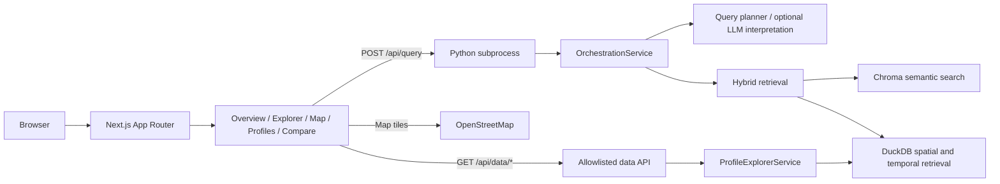

# Stage 10: OceanIQ interactive dashboard

## Purpose and status

The Next.js dashboard provides a browser interface over the existing Python query orchestration and a small set of bounded, read-only DuckDB profile-exploration operations. It does not duplicate scientific retrieval, ranking, or database access in the browser.

Stage 10 has been exercised locally against the recovered DuckDB dataset. Frontend lint/build, the backend regression suite, live API calls, and browser flows are listed under [Validation](#validation). This is local verification, not a production deployment certification.

## Architecture



The profile data endpoints use the existing shared DuckDB service. Each Next.js request starts a Python subprocess in the repository virtual environment; the implementation is local-development oriented and may have noticeable per-request startup latency. No browser request can submit SQL.

## Pages and components

- `frontend/src/app/page.tsx` — overview metrics, non-null field counts, UTC observation coverage, coordinate bounds, configured regional profile counts, schema/identifier caveats, and recent browser-local query history.
- `frontend/src/app/explorer/page.tsx` and `frontend/src/components/chat/query-explorer.tsx` — natural-language query UI calling the existing orchestration API, with query plan, filters, warnings, ranking explanation, results, limitations, and up to ten local-history entries.
- `frontend/src/app/map/page.tsx` and `frontend/src/components/map/argo-map.tsx` — interactive Leaflet map with region, date, parameter, identifier text, and coordinate-range filters. Markers represent actual profile locations; selection exposes profile metadata and detail/compare links.
- `frontend/src/app/profiles/page.tsx` — searchable, filterable, 50-row profile pages, current-page sorting, and selection of up to four profiles.
- `frontend/src/app/profiles/detail/page.tsx` and `frontend/src/components/profiles/profile-detail-view.tsx` — profile metadata, measurement-level table, and plots of observed temperature, salinity, and temperature/salinity pairs.
- `frontend/src/app/compare/page.tsx` — overlays up to four selected profiles, reports coordinate/time differences, and identifies missing parameter series.
- `frontend/src/app/about/page.tsx` — explains processed fields, identifier meaning, UTC, pressure semantics, and QC/coverage limitations.
- `frontend/src/app/layout.tsx` — sets application metadata and wraps routes with shared navigation.
- `frontend/src/app/globals.css` — defines the responsive dashboard and component styles on top of Tailwind.
- `frontend/src/components/layout/app-shell.tsx` — responsive shared navigation.
- `frontend/src/components/charts/profile-charts.tsx` — Recharts scatter plots using only observed measurements. No interpolation is performed.
- `frontend/src/lib/api.ts`, `frontend/src/lib/types.ts`, and `frontend/src/lib/format.ts` — typed same-origin API helpers, response contracts, and formatting.

The frontend uses Next.js/React and Tailwind CSS from the existing app, plus `recharts` for charts, `react-leaflet`/`leaflet` for maps, and `lucide-react` for icons. `@types/leaflet` supplies Leaflet TypeScript declarations.

## Backend service contract

`backend/services/profile_explorer_service.py` exposes:

- `get_profile_explorer_service() -> ProfileExplorerService` — returns the module-level service singleton.
- `ProfileExplorerService.get_summary() -> dict[str, Any]` — returns counts, non-null variable rows, UTC min/max timestamps, coordinate ranges, configured regional counts, supported fields, and explicit QC/float-identifier notes.
- `ProfileExplorerService.list_profiles(*, limit=50, offset=0, search=None, parameter=None, region=None, start_datetime=None, end_datetime=None, latitude_min=None, latitude_max=None, longitude_min=None, longitude_max=None) -> dict[str, Any]` — returns a grouped page, total count, page size, and offset. A profile identity is `(file_name, profile_number)`; `float_id` remains a separate project key.
- `ProfileExplorerService.map_profiles(*, limit=1000, region=None, search=None, parameter=None, start_datetime=None, end_datetime=None, latitude_min=None, latitude_max=None, longitude_min=None, longitude_max=None) -> dict[str, Any]` — returns a bounded set of distinct geolocated profile markers. The service caps results at 2,000; the UI requests at most 1,500.
- `ProfileExplorerService.get_profile(file_name, profile_number, *, limit=5000) -> dict[str, Any] | None` — returns profile metadata and up to 10,000 measurement levels, or `None` when the identity is absent. The detail page requests 3,000 levels; comparison requests 2,000 per profile.

All data filters are passed as bound SQL parameters. Supported parameter-availability filters are `temperature`, `salinity`, and `depth`. The end date supplied as a date-only value is inclusive through that UTC day. Naive timestamp inputs are interpreted as UTC; timezone-aware inputs are normalized to UTC.

## HTTP interface

### `POST /api/query`

Request JSON: `{"question":"Find temperature observations in the Arabian Sea."}`. The route validates a non-empty question, invokes the existing `OrchestrationService.execute`, and serializes its structured response. Planner/retrieval failures are not converted into successful results.

### `GET /api/data/summary`

Returns dataset counts, coverage, coordinate ranges, configured region counts, available fields, and identifier/QC notes.

### `GET /api/data/profiles`

Accepts `limit`, `offset`, `search`, `parameter`, `region`, `start_datetime`, `end_datetime`, and optional latitude/longitude min/max values. The response includes `results`, `total_count`, `limit`, and `offset`. Service page size is capped at 200; the UI uses 50.

### `GET /api/data/map`

Accepts the profile filters above except `offset`, and a `limit`. Returns `results`, `returned_count`, and the applied cap. Map profiles without coordinates are excluded.

### `GET /api/data/profile`

Accepts `file_name`, `profile_number`, and optional `limit`; returns one profile's bounded metadata/measurement payload or an empty result. The source filename is provenance and is never represented as a float ID.

The dynamic API route at `frontend/src/app/api/data/[action]/route.ts` allowlists the four actions and exposes only these fixed service methods. Invalid inputs return client errors; unexpected backend errors return a server error.

## Data interpretation and limits

- Current local data contains 68,470,264 observation rows, 52,240 distinct `(file_name, profile_number)` profiles, and 706 project float keys/source files. Dataset coverage is 2022-01-01 through 2024-12-20 UTC.
- The processed schema includes `file_name`, project `float_id`, profile/cycle numbers, UTC observation time, coordinates, `depth`, temperature, and salinity. The stored `depth` field comes from NetCDF `PRES`; the UI labels plots as pressure (dbar) and does not convert it to geometric depth.
- QC flags are absent from this processed table. The dashboard explicitly reports QC as unavailable, not as passing.
- No separate raw `PLATFORM_NUMBER` column is retained in DuckDB, so project `float_id` must not be presented as a verified raw WMO identifier.
- Hybrid retrieval results are float-level summaries; the profile explorer uses `(file_name, profile_number)` to access individual profiles.
- Map results are capped for browser responsiveness. OpenStreetMap tiles loaded during the local browser check; future tile availability depends on external network access.
- The Next.js route starts a Python process per request. There is no persistent Python HTTP service, connection pool, authentication layer, or production hosting configuration in this stage.
- Browser history is stored in that browser's `localStorage`; it is not a server-side conversation store.

## Setup and execution

From the project root:

```powershell
Set-Location D:\FloatChat\frontend
npm install
npm run dev
```

Open the printed local URL. The query and data API routes expect the project virtual environment at `D:\FloatChat\.venv\Scripts\python.exe`, installed backend dependencies, and processed DuckDB/Chroma artifacts. To verify a production build:

```powershell
npm run lint
npm run build
npm start
```

From the project root, backend tests run with:

```powershell
.\.venv\Scripts\python.exe -m pytest backend\tests -q
```

## Validation

Verified locally:

- `npm run lint` — passed.
- `npm run build` — passed; overview, explorer, map, profile list/detail, comparison, and both API route families compiled.
- `.\.venv\Scripts\python.exe -m pytest backend\tests -q` — 63 passed, 20 existing Pandas deprecation warnings.
- Live responses from summary, profile list, map, profile detail, and query APIs returned actual DuckDB/orchestration data.
- Live query example: “Find temperature observations in the Arabian Sea.” returned `retrieval_status=success`, `result_count=1`, and the actual project key/source file in the float-level candidate.
- Map returned 1,500 unfiltered locations; filtering for Bay of Bengal profiles with temperature data returned 1,275 locations. The map rendered 1,500 interactive profile markers and OpenStreetMap tiles; selecting a marker exposed the corresponding profile metadata.
- A 390px-wide browser viewport rendered profile details, measurement charts, and navigation; the navigation uses intentional horizontal scrolling.
- Two actual profiles from the same source file were compared: the UI displayed distinct profile numbers, actual overlays, a 586.7 km coordinate separation, a 0.1 hour time difference, and a missing-salinity notice for the profile without salinity values.
- Invalid latitude/date filters returned explicit validation errors. The UI was adjusted so failed filters do not also display a misleading “no matches” empty state.
- Browser checks exercised overview, query, map, profile listing/detail, profile charts, profile comparison, and empty/error states.

Remote deployment behavior is not verified. The backend test suite has automated coverage; frontend flows were manually exercised in the local browser rather than through an automated browser-test suite. Dependency installation reported seven moderate npm audit findings; dependency remediation was not part of this stage.
