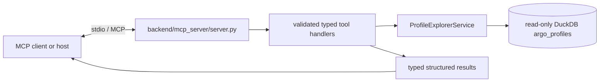

# Stage 11: MCP Server Integration

## Purpose and boundary

OceanIQ provides an independently runnable, read-only Model Context Protocol server so compatible clients can call bounded ARGO profile-exploration operations. The server is an adapter over the existing `ProfileExplorerService`; it does not replace the dashboard, hybrid retrieval engine, query planner, or LLM integration.



The server does not expose arbitrary SQL, ingestion, Chroma, hybrid ranking, LLM calls, or database writes. Tool handlers call parameterized service functions and return typed models from `backend/mcp_server/schemas.py`.

## Implementation files and interfaces

### `backend/mcp_server/server.py`

- `create_server(tools: OceanIQMCPTools | None = None, service: ProfileExplorerService | None = None) -> MCPServer` creates an SDK server and registers the five tools. When no service is supplied, it reuses `get_profile_explorer_service()`.
- `main() -> None` runs the server with the SDK stdio transport.
- Supported launch command: from `D:\FloatChat\backend`, run `..\.venv\Scripts\python.exe -m mcp_server.server`.

### `backend/mcp_server/tools.py`

`OceanIQMCPTools(service: ProfileExplorerService | None = None)` accepts an injectable service for tests and uses a shared service instance for tool calls. The service operations are guarded by a per-instance lock and errors are reported as MCP `ToolError`s. Unexpected service errors are logged by exception type and returned to clients with a generic message, not internal configuration or query details.

| Handler | Interface and output |
|---|---|
| `search_argo_profiles(...) -> SearchProfilesResponse` | Optional parameter, region, ISO start/end date, latitude/longitude bounds, substring search, and `limit` (1–200). Delegates to `list_profiles`; the response includes only filters actually passed and enforced, a count, and returned profile identities. |
| `get_float_details(float_id: str) -> FloatDetailsResponse` | Exact processed project `float_id`; returns stored profile/file/observation counts, coverage, coordinate ranges, and available parameters, or `not_found`. |
| `get_profile_observations(profile_id, parameters=None, pressure_min_dbar=None, pressure_max_dbar=None, limit=500) -> ProfileObservationsResponse` | `profile_id` must be `<source_file>#profile=<positive_number>`. Response limit is 1–2,000; underlying service fetch is capped at 10,000 levels. |
| `compare_profiles(profile_ids, parameter, pressure_min_dbar=None, pressure_max_dbar=None) -> CompareProfilesResponse` | Accepts 2–4 unique profile IDs and `temperature` or `salinity`. Returns independent observed series, up to 2,000 points per profile, and reports missing/incomplete identities. There is no interpolation. |
| `get_dataset_summary() -> DatasetSummaryResponse` | No arguments; reuses the existing summary operation and its actual counts, time coverage, regional counts, and data limitations. |

The four predefined geographic regions are `Arabian Sea`, `Bay of Bengal`, `Equatorial Indian Ocean`, and `Southern Indian Ocean`; the existing service also supports `Indian Ocean`. Search supports `temperature`, `salinity`, and `depth`. No radius filter is exposed because the profile explorer's existing API does not provide radius filtering.

### `backend/mcp_server/schemas.py`

Defines strict Pydantic responses for profile summaries, exact float aggregates, observation levels, comparisons, and dataset summary. Responses distinguish `success`, `success_empty`, `not_found`, and `partial` where applicable. Structured outputs retain profile ID, source filename, and project `float_id` as separate values.

### `backend/services/profile_explorer_service.py`

`get_float_details(float_id: str) -> dict[str, Any] | None` was added. It uses a parameterized exact `float_id = ?` query and aggregates counts, UTC observation bounds, coordinate ranges, and parameter availability. It explicitly returns `identifier_type="project_float_id"`, `platform_number_available=False`, and `qc_available=False`. It does not interpret source filenames as float IDs.

### `backend/tests/test_mcp_server.py`

Uses a controlled in-memory DuckDB table and the official SDK client. It tests each tool, empty/not-found cases, identity and pressure filtering, validation and safe errors, structured MCP calls, and stdio process startup/tool discovery.

## Data identity and scientific interpretation

- `float_id` is the project-level identifier stored in the processed table, not a guarantee of raw ARGO WMO identity.
- The raw source variable for ARGO platform identity is NetCDF `PLATFORM_NUMBER`; the processed DuckDB schema does not retain it as a separate field.
- Profile identity is `(source_file, profile_number)`. The MCP profile key syntax is `<source_file>#profile=<profile_number>`.
- A source filename is provenance, not a float identifier. Profile IDs reject path separators.
- The stored `depth` field originates from NetCDF `PRES`; pressure range inputs and comparison axes are labeled dbar. No geometric-depth conversion is performed.
- QC fields are absent. Results report QC as unavailable and do not imply observations passed QC.
- Comparison results contain actual measured pairs and do not align or interpolate observations.
- Dates must be ISO-8601. Naive timestamps are interpreted in UTC; a date-only end date includes the full UTC day using the existing service's range behavior.

## Installation and execution

The backend dependency manifest includes `mcp>=2.3.0,<3.0`, the official Python SDK version range. Install backend requirements into the project virtual environment if necessary.

From PowerShell:

```powershell
Set-Location D:\FloatChat\backend
..\.venv\Scripts\python.exe -m mcp_server.server
```

The process communicates on stdin/stdout and is intended to be launched by a compatible MCP host. Do not use stdout for application logs. No API key, LLM provider, Chroma index, or GPU is required.

Run the backend regression suite from the project root:

```powershell
..\.venv\Scripts\python.exe -m pytest backend\tests -q
```

## Validation and verified status

- Full backend regression: **80 passed**, with **20 existing Pandas 4 deprecation warnings** from `backend/services/spatial_temporal_service.py` using `DataFrame.drop(inplace=...)`.
- Focused Stage 11 tests: **16 passed**.
- The official in-process MCP client discovered and called all five tools against controlled DuckDB data, and invalid tool calls returned MCP errors.
- The official stdio client successfully started the standalone server and discovered all five registered tools.
- A local stdio smoke test against the recovered DuckDB returned a successful summary with 68,470,264 observations, two returned temperature profiles, successful float details and observation results, and a non-error comparison result. An out-of-range latitude returned an MCP tool error.
- The added exact project-float aggregation has focused in-memory DuckDB coverage in `test_profile_explorer.py`.

### Not verified / limitations

- External desktop/remote MCP host configuration, deployment, authentication, and cross-host compatibility are not verified.
- The live smoke test confirms local functionality, not performance or resource behavior under heavy production traffic.
- Result caps are hard limits; observation retrieval can be truncated.
- Raw `PLATFORM_NUMBER` and QC are unavailable in the processed table.
- The server uses the current local DuckDB configuration and is not a production hosting or authentication layer.

Stage 11 is verified within the controlled-data and local stdio scope above. Stage 12 has not been started.
